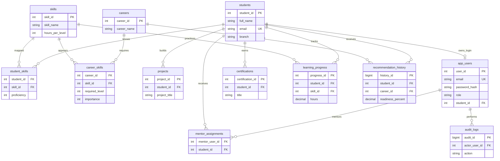

# Extended SkillSync ER Diagram (MySQL)

The original six tables are still present. These six new supporting tables extend the full project.

**MongoDB:** `skillsync_nosql.mentor_feedback`, a separate document collection with nested recommended skills and mentor notes. Cross-database association is by `student_id` in new documents, falling back to the previous name-only demo record when needed.
